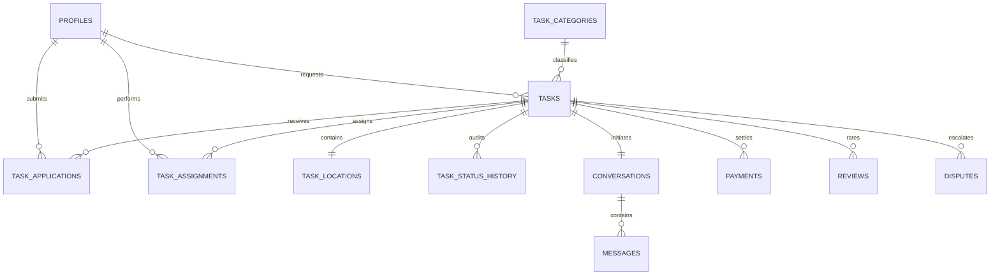

# PART – Database Architecture & PostgreSQL Schema

This document provides complete documentation of the PostgreSQL database architecture, entity relationships, Row-Level Security (RLS) policies, triggers, and geospatial functions for **PART – People At Right Time**.

---

## 1. Schema Overview

The database uses PostgreSQL with the PostGIS extension (with built-in spherical trigonometric Haversine fallback). It contains **23 normalized tables** designed for high throughput, strict data isolation, and auditability.



---

## 2. Enumerated Types (Enums)

| Enum Name | Allowed Values | Description |
|---|---|---|
| `task_status_enum` | `DRAFT`, `OPEN`, `ASSIGNED`, `IN_PROGRESS`, `COMPLETION_SUBMITTED`, `COMPLETED`, `CANCELLED`, `DISPUTED` | Strict task lifecycle states |
| `application_status_enum` | `applied`, `shortlisted`, `accepted`, `rejected`, `withdrawn` | Worker application state |
| `assignment_status_enum` | `assigned`, `in_progress`, `completion_submitted`, `completed`, `cancelled`, `disputed` | Worker contract state |
| `payment_status_enum` | `PENDING`, `INITIATED`, `SUCCESS`, `FAILED`, `REFUNDED` | Payment lifecycle state |
| `payment_method_enum` | `CASH_ON_COMPLETION`, `SANDBOX_ONLINE`, `RAZORPAY` | Payment settlement modes |
| `dispute_status_enum` | `OPEN`, `UNDER_REVIEW`, `RESOLVED_REFUND`, `RESOLVED_PAY_WORKER`, `DISMISSED` | Dispute adjudication |
| `verification_status_enum` | `unverified`, `pending`, `verified`, `rejected` | User ID verification status |

---

## 3. Entity Dictionary (23 Tables)

### 1. `profiles`
Stores extended user profile information linked directly to `auth.users`.
* `id` (UUID, PK, FK -> `auth.users.id` ON DELETE CASCADE)
* `full_name` (TEXT, NOT NULL)
* `phone` (TEXT)
* `avatar_url` (TEXT)
* `bio` (TEXT)
* `preferred_language` (VARCHAR(5), DEFAULT 'en', CHECK: 'en' OR 'ta')
* `city` (TEXT, NOT NULL DEFAULT 'Chennai')
* `general_location` (TEXT) - e.g. "Anna Nagar, Chennai" (Masked from public)
* `is_admin` (BOOLEAN, DEFAULT FALSE)
* `is_worker_available` (BOOLEAN, DEFAULT TRUE)
* `verification_status` (`verification_status_enum`, DEFAULT 'unverified')
* `rating_as_worker` (NUMERIC(3,2), DEFAULT 5.00, CHECK: 1.00 - 5.00)
* `total_reviews_as_worker` (INTEGER, DEFAULT 0)
* `completed_tasks_as_worker` (INTEGER, DEFAULT 0)
* `rating_as_requester` (NUMERIC(3,2), DEFAULT 5.00)
* `total_reviews_as_requester` (INTEGER, DEFAULT 0)
* `completed_tasks_as_requester` (INTEGER, DEFAULT 0)
* `created_at`, `updated_at` (TIMESTAMPTZ)

### 2. `user_skills`
Stores normalized skills declared by workers.
* `id` (UUID, PK)
* `user_id` (UUID, FK -> `profiles.id` ON DELETE CASCADE)
* `skill_name` (TEXT, NOT NULL)
* `CONSTRAINT unique_user_skill UNIQUE (user_id, skill_name)`

### 3. `task_categories`
7 core task categories with bilingual English and Tamil names.
* `id` (UUID, PK)
* `slug` (TEXT, UNIQUE, NOT NULL)
* `name_en` (TEXT, NOT NULL)
* `name_ta` (TEXT, NOT NULL)
* `description_en` (TEXT, NOT NULL)
* `description_ta` (TEXT, NOT NULL)
* `icon` (TEXT, NOT NULL)
* `safety_guidelines` (JSONB, NOT NULL)
* `is_active` (BOOLEAN, DEFAULT TRUE)
* `display_order` (INTEGER, DEFAULT 0)

### 4. `tasks`
Central marketplace entity representing a requested gig.
* `id` (UUID, PK)
* `requester_id` (UUID, FK -> `profiles.id` ON DELETE CASCADE)
* `category_id` (UUID, FK -> `task_categories.id` ON DELETE RESTRICT)
* `title` (TEXT, CHECK: 5 <= len <= 100)
* `description` (TEXT, CHECK: 15 <= len <= 2000)
* `budget_inr` (NUMERIC(10,2), CHECK: 50 <= budget <= 50000)
* `estimated_duration_minutes` (INTEGER, CHECK: 10 <= dur <= 1440)
* `preferred_date` (DATE, NOT NULL)
* `preferred_time_window` (TEXT)
* `required_workers_count` (INTEGER, DEFAULT 1, CHECK: 1 <= count <= 10)
* `assigned_workers_count` (INTEGER, DEFAULT 0)
* `required_skills` (JSONB, DEFAULT '[]')
* `special_instructions` (TEXT)
* `status` (`task_status_enum`, DEFAULT 'OPEN')
* `created_at`, `updated_at` (TIMESTAMPTZ)

### 5. `task_locations`
Geographic coordinates and locality information.
* `id` (UUID, PK)
* `task_id` (UUID, UNIQUE, FK -> `tasks.id` ON DELETE CASCADE)
* `city` (TEXT, DEFAULT 'Chennai')
* `locality` (TEXT, NOT NULL) - e.g. "Velachery"
* `address_approximate` (TEXT, NOT NULL) - Public landmark
* `address_exact` (TEXT) - Private exact house address (RLS protected)
* `latitude` (DOUBLE PRECISION, CHECK: -90 to 90)
* `longitude` (DOUBLE PRECISION, CHECK: -180 to 180)
* `postal_code` (VARCHAR(12))

### 6. `task_applications`
Worker bids / applications to open tasks.
* `id` (UUID, PK)
* `task_id` (UUID, FK -> `tasks.id` ON DELETE CASCADE)
* `worker_id` (UUID, FK -> `profiles.id` ON DELETE CASCADE)
* `pitch_message` (TEXT, CHECK: len <= 500)
* `status` (`application_status_enum`, DEFAULT 'applied')
* `CONSTRAINT unique_task_worker_application UNIQUE (task_id, worker_id)`

### 7. `task_assignments`
Formal assignment contract between requester and worker.
* `id` (UUID, PK)
* `task_id` (UUID, FK -> `tasks.id` ON DELETE CASCADE)
* `worker_id` (UUID, FK -> `profiles.id` ON DELETE CASCADE)
* `application_id` (UUID, FK -> `task_applications.id`)
* `status` (`assignment_status_enum`, DEFAULT 'assigned')
* `agreed_rate_inr` (NUMERIC(10,2), NOT NULL)
* `assigned_at`, `started_at`, `completed_at` (TIMESTAMPTZ)

### 8. `task_status_history`
Append-only audit trail of every status transition.
* `id` (UUID, PK)
* `task_id` (UUID, FK -> `tasks.id` ON DELETE CASCADE)
* `previous_status` (`task_status_enum`)
* `new_status` (`task_status_enum`, NOT NULL)
* `changed_by` (UUID, FK -> `profiles.id`)
* `notes` (TEXT)
* `created_at` (TIMESTAMPTZ)

### 9. `conversations`
Chat thread created automatically when a worker is assigned.
* `id` (UUID, PK)
* `task_id` (UUID, FK -> `tasks.id` ON DELETE CASCADE)

### 10. `conversation_participants`
* `id` (UUID, PK)
* `conversation_id` (UUID, FK -> `conversations.id` ON DELETE CASCADE)
* `user_id` (UUID, FK -> `profiles.id` ON DELETE CASCADE)
* `last_read_at` (TIMESTAMPTZ)
* `CONSTRAINT unique_conversation_user UNIQUE (conversation_id, user_id)`

### 11. `messages`
* `id` (UUID, PK)
* `conversation_id` (UUID, FK -> `conversations.id` ON DELETE CASCADE)
* `sender_id` (UUID, FK -> `profiles.id` ON DELETE CASCADE)
* `content` (TEXT, NOT NULL, CHECK: 1 <= len <= 3000)
* `created_at` (TIMESTAMPTZ)

### 12. `message_attachments`
* `id` (UUID, PK)
* `message_id` (UUID, FK -> `messages.id` ON DELETE CASCADE)
* `file_url` (TEXT, NOT NULL)
* `file_type` (TEXT, NOT NULL)
* `file_size_bytes` (INTEGER, CHECK: <= 10MB)

### 13. `task_completion_evidence`
Worker submission of evidence before requester approval.
* `id` (UUID, PK)
* `task_id` (UUID, FK -> `tasks.id` ON DELETE CASCADE)
* `assignment_id` (UUID, FK -> `task_assignments.id` ON DELETE CASCADE)
* `submitted_by` (UUID, FK -> `profiles.id`)
* `notes` (TEXT, NOT NULL)
* `photo_urls` (JSONB, DEFAULT '[]')

### 14. `payments`
Ledger of task payment settlements.
* `id` (UUID, PK)
* `task_id` (UUID, FK -> `tasks.id` ON DELETE CASCADE)
* `payer_id` (UUID, FK -> `profiles.id`)
* `payee_id` (UUID, FK -> `profiles.id`)
* `total_amount_inr` (NUMERIC(10,2), CHECK: > 0)
* `platform_fee_inr` (NUMERIC(10,2), CHECK: >= 0)
* `worker_amount_inr` (NUMERIC(10,2), CHECK: >= 0)
* `platform_fee_percent` (NUMERIC(5,2), DEFAULT 10.00)
* `status` (`payment_status_enum`, DEFAULT 'PENDING')
* `payment_method` (`payment_method_enum`, NOT NULL)
* `provider_reference` (TEXT)
* `settled_at` (TIMESTAMPTZ)

### 15. `payment_events`
Audit logs of webhook and gateway status changes.
* `id` (UUID, PK)
* `payment_id` (UUID, FK -> `payments.id` ON DELETE CASCADE)
* `event_type` (TEXT, NOT NULL)
* `payload` (JSONB)

### 16. `reviews`
Reciprocal ratings (1-5 stars) and feedback.
* `id` (UUID, PK)
* `task_id` (UUID, FK -> `tasks.id` ON DELETE CASCADE)
* `reviewer_id` (UUID, FK -> `profiles.id`)
* `reviewee_id` (UUID, FK -> `profiles.id`)
* `role_reviewed` (TEXT, CHECK: 'worker' OR 'requester')
* `rating` (INTEGER, CHECK: 1 <= rating <= 5)
* `feedback` (TEXT, CHECK: 5 <= len <= 1000)
* `CONSTRAINT unique_task_reviewer_reviewee UNIQUE (task_id, reviewer_id, reviewee_id)`

### 17. `notifications`
* `id` (UUID, PK)
* `user_id` (UUID, FK -> `profiles.id` ON DELETE CASCADE)
* `title` (TEXT, NOT NULL)
* `body` (TEXT, NOT NULL)
* `event_type` (TEXT, NOT NULL)
* `reference_type` (TEXT), `reference_id` (TEXT)
* `is_read` (BOOLEAN, DEFAULT FALSE)

### 18. `reports`
User safety reports for admin review.
* `id` (UUID, PK)
* `reporter_id` (UUID, FK -> `profiles.id`)
* `reported_user_id` (UUID, FK -> `profiles.id`)
* `reported_task_id` (UUID, FK -> `tasks.id`)
* `reason` (TEXT, NOT NULL)
* `details` (TEXT)
* `status` (TEXT, DEFAULT 'PENDING', CHECK: 'PENDING', 'RESOLVED', 'DISMISSED')

### 19. `disputes`
Escalated contractual disputes on active or completed tasks.
* `id` (UUID, PK)
* `task_id` (UUID, FK -> `tasks.id` ON DELETE CASCADE)
* `raised_by` (UUID, FK -> `profiles.id`)
* `reason` (TEXT, NOT NULL)
* `details` (TEXT, NOT NULL)
* `status` (`dispute_status_enum`, DEFAULT 'OPEN')
* `resolution_notes` (TEXT)
* `resolved_by` (UUID, FK -> `profiles.id`)
* `resolved_at` (TIMESTAMPTZ)

### 20. `user_blocks`
User-level privacy blocking controls.
* `id` (UUID, PK)
* `blocker_id` (UUID, FK -> `profiles.id`)
* `blocked_id` (UUID, FK -> `profiles.id`)
* `CONSTRAINT unique_user_block UNIQUE (blocker_id, blocked_id)`

### 21. `verification_records`
National ID / Aadhaar verification audit storage.
* `id` (UUID, PK)
* `user_id` (UUID, FK -> `profiles.id`)
* `document_type` (TEXT), `document_url` (TEXT)
* `status` (`verification_status_enum`, DEFAULT 'pending')

### 22. `admin_audit_logs`
Immutable audit log of admin operations.
* `id` (UUID, PK)
* `admin_id` (UUID, FK -> `profiles.id`)
* `action` (TEXT), `target_entity` (TEXT), `target_id` (TEXT)
* `details` (JSONB)
* `ip_address` (TEXT)

### 23. `platform_settings`
Configurable operational parameters.
* `id` (UUID, PK)
* `platform_fee_percent` (NUMERIC(5,2), DEFAULT 10.00)
* `currency` (VARCHAR(10), DEFAULT 'INR')
* `support_phone` (TEXT, DEFAULT '+91 44 2827 0000')
* `support_email` (TEXT, DEFAULT 'support@part-app.in')
* `min_task_budget_inr` (NUMERIC, DEFAULT 50.00)
* `max_task_budget_inr` (NUMERIC, DEFAULT 50000.00)

---

## 4. Stored Procedures & Geospatial Queries

### Geospatial Proximity RPC: `get_nearby_tasks`
Computes the spherical great-circle distance between the user's GPS coordinates and all open tasks in Chennai using the Haversine equation:

$$d = 2R \arcsin\left(\sqrt{\sin^2\left(\frac{\Delta\phi}{2}\right) + \cos(\phi_1)\cos(\phi_2)\sin^2\left(\frac{\Delta\lambda}{2}\right)}\right)$$

Where $R = 6371\text{ km}$. Indexes on `(latitude, longitude)` provide sub-10ms response times.

### Concurrency-Safe Worker Assignment: `assign_worker_to_task`
Acquires an exclusive row lock on `tasks` via `SELECT ... FOR UPDATE`:
1. Validates `requester_id = auth.uid()`
2. Prevents self-assignment (`requester_id != worker_id`)
3. Asserts `assigned_workers_count < required_workers_count`
4. Creates `task_assignments` record
5. Automatically increments `assigned_workers_count` and updates status to `ASSIGNED`
6. Creates or attaches the conversation record for participants.

---

## 5. PostGIS Location Tracking & Geospatial System (Migration 0003)

### 24. `saved_addresses`
Stores user bookmarked locations (Home, Work, Other) with PostGIS Point geometries.
* `id` (UUID, PK, DEFAULT `gen_random_uuid()`)
* `user_id` (UUID, FK -> `profiles.id` ON DELETE CASCADE)
* `label` (TEXT, CHECK: `'Home' | 'Work' | 'Other'`)
* `title` (TEXT, NOT NULL)
* `address_line` (TEXT, NOT NULL)
* `locality` (TEXT, NOT NULL)
* `latitude` (DOUBLE PRECISION, NOT NULL)
* `longitude` (DOUBLE PRECISION, NOT NULL)
* `location` (`GEOMETRY(Point, 4326)`, GENERATED ALWAYS AS `ST_SetSRID(ST_MakePoint(longitude, latitude), 4326)` STORED)
* `is_default` (BOOLEAN, DEFAULT FALSE)
* `created_at` (TIMESTAMPTZ, DEFAULT NOW())

**Spatial Index**: `CREATE INDEX idx_saved_addresses_location ON public.saved_addresses USING GIST(location);`

**RLS Policy**:
```sql
CREATE POLICY "Users can view and manage their own saved addresses"
  ON public.saved_addresses FOR ALL TO authenticated
  USING (auth.uid() = user_id) WITH CHECK (auth.uid() = user_id);
```

### 25. `task_worker_locations`
Stores real-time worker GPS coordinates for accepted and in-progress tasks.
* `task_id` (UUID, FK -> `tasks.id` ON DELETE CASCADE)
* `worker_id` (UUID, FK -> `profiles.id` ON DELETE CASCADE)
* `latitude` (DOUBLE PRECISION, NOT NULL)
* `longitude` (DOUBLE PRECISION, NOT NULL)
* `location` (`GEOMETRY(Point, 4326)`, GENERATED ALWAYS AS `ST_SetSRID(ST_MakePoint(longitude, latitude), 4326)` STORED)
* `heading` (DOUBLE PRECISION)
* `speed` (DOUBLE PRECISION)
* `accuracy` (DOUBLE PRECISION)
* `updated_at` (TIMESTAMPTZ, DEFAULT NOW())
* `PRIMARY KEY (task_id, worker_id)`

**Realtime Replication**:
```sql
ALTER PUBLICATION supabase_realtime ADD TABLE public.task_worker_locations;
```

**Security & Privacy RLS**:
* **Read (SELECT)**: Scoped strictly to task participants (`requester_id` OR `assigned_worker_id`) and ONLY while task is in active state (`ASSIGNED` or `IN_PROGRESS`). Automatically terminates access upon task completion or cancellation.
* **Write (INSERT/UPDATE)**: Only the assigned worker (`worker_id = auth.uid()`) can publish coordinates for an active gig.

### PostGIS Radial Discovery RPC: `get_nearby_tasks_within_radius`
Filters tasks within precise spherical radii (1km, 3km, 5km, 10km) using PostGIS geography:
```sql
SELECT t.id, t.title, t.budget_inr, tl.locality,
  ROUND((ST_Distance(tl.location::geography, ST_SetSRID(ST_MakePoint(p_lng, p_lat), 4326)::geography) / 1000.0)::numeric, 2) AS distance_km
FROM public.tasks t
JOIN public.task_locations tl ON tl.task_id = t.id
WHERE t.status = 'OPEN'
  AND ST_DWithin(tl.location::geography, ST_SetSRID(ST_MakePoint(p_lng, p_lat), 4326)::geography, p_radius_km * 1000.0)
ORDER BY distance_km ASC;
```

